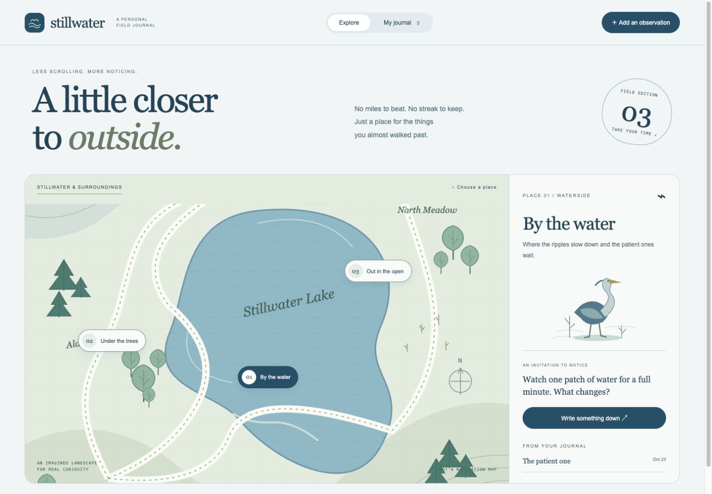

# HensTek Sample Set 03 — Stillwater

A personal nature journal for the things you almost walked past. **Quiet Atlas** uses cool blue, sage, lavender, original landscape illustrations and quiet serif typography. This set explores a hobby rather than a business.

[Explore Set 03](https://recondemon.github.io/henstek-sample-set-03/) · [HensTek gallery](https://henstek.dev/samples#sample-set-03) · [Discuss your version](https://henstek.dev/start?sample=set-03)

| Reference | Working example | Try it |
| --- | --- | --- |
| **SW-03 / Web** | An illustrated landscape, place-specific prompts, observation editor, favorites and searchable journal | [Live web app](https://recondemon.github.io/henstek-sample-set-03/web/) |
| **SW-03 / Mobile** | A native SwiftUI pocket journal, places, search, favorites and JSON import/export | [iPhone source and guide](samples/mobile/README.md) |
| **SW-03 / Desktop** | A three-pane writing workspace with place filters, search, entry editing and portable backups | [Browser preview](https://recondemon.github.io/henstek-sample-set-03/desktop/) · [Native setup](samples/desktop/README.md) |



## Run locally

Use Node.js 22.12 or newer. Checks use Node 24.

```sh
git clone https://github.com/recondemon/henstek-sample-set-03.git
cd henstek-sample-set-03
npm ci
npm run dev
```

Open `http://127.0.0.1:4333`. The server builds and serves `docs/`; run `npm run build` after editing source. Browser samples require no keys, accounts or runtime packages. Platform setup is documented in each sample directory.

## A journal you can carry

Each app stores its own local data. Export a **Stillwater version 1 JSON journal**, then import that file into another sample to move your observations manually. There is no automatic synchronization, account or server database. Import replaces the destination journal after confirmation; export its current copy first.

The format supports 100 entries and a 500 KB file limit, with titles up to 80 UTF-16 code units and notes up to 4,000. Dates run from 1900 through 2100. Validation rejects malformed dates, duplicate IDs and unknown places or kinds. Native saves retain a previous revision; damaged files are not silently replaced. Browser storage can be cleared by the browser, so keep exports for anything you want to retain. Exports are readable JSON and are not encrypted.

The landscape, places and observations are fictional. This is not a route planner, navigation map, species identification tool or wildlife guide. There is no location tracking or weather feed. The illustrations are included as editable vectors; the mobile landscape is drawn with SwiftUI Canvas.

## Mix the parts that suit your idea

Functional references: `set-03-website`, `set-03-iphone`, `set-03-desktop`.
Visual references: `sw-03-web`, `sw-03-mobile`, `sw-03-desktop`.

For example: **“SW-03 / Mobile journaling with SA-02 / Web colors and type.”** [Prepare that mixed brief](https://henstek.dev/start?sample=set-03-iphone&style=sa-02-web).

A set number identifies a scenario and design, not a software version. Record the source commit, functionality and style when agreeing a commissioned scope.

## Checks and source layout

```sh
npm run build
npm test
npm run test:mobile
```

`shared/` holds the browser journal schema and editor. `samples/` contains platform sources. `public/` is the collection page, `screenshots/` contains actual captures, `fixtures/` contains a compatible fictional export, and `docs/` is generated Pages output. Build before running desktop so its shared sources are current.

Native checks cover iPhone Simulator and Apple silicon macOS. No App Store listing, Android build, signed/notarized installer or Windows verification is included.

Code and included sample assets are [MIT licensed](LICENSE); dependency licenses remain their own. Keep the license notice when redistributing. HensTek branding does not imply endorsement.

[Customer walkthrough](CUSTOMER-WALKTHROUGH.md) · [Verification](VERIFICATION.md) · [Contributing](CONTRIBUTING.md) · [Security](SECURITY.md)

## Try every platform in the gallery

Click a sample screen or **Try interactive preview** to open the working demo without leaving the gallery. Web and desktop use their existing browser interfaces; `/mobile/` is a browser adaptation of the SwiftUI screens. It is not an iOS emulator and does not include native device or file integrations. Mobile edits live in memory until reload or Reset demo. The viewer keeps the reference label and inquiry link visible. Press Escape or Close to return; Open separately is available if browser embedding/storage is restricted.
